<p align="center">
  " width="100%" />
</p>

<p align="center">
  
</p>

---

### Sobre mí

```java
public class Moy extends Developer {

    String rol = "Full Stack Developer";
    String[] enfoque = { "Web", "Móvil", "PWAs", "APIs seguras" };
    String[] movil = { "Ionic", "React Native" };
    String filosofia = "Código limpio, interfaces simples";
    String github = "github.com/moy2005";

    @Override
    public void aprender() {
        while (true) nuevaTecnologia();
    }
}
```

### Tecnologías

<p align="center">
  
  <br />
  
  <br />
  
</p>

###  IA

<p align="center">
  
</p>

### Estadísticas

<p align="center">
  
  
</p>

<p align="center">
  
</p>
